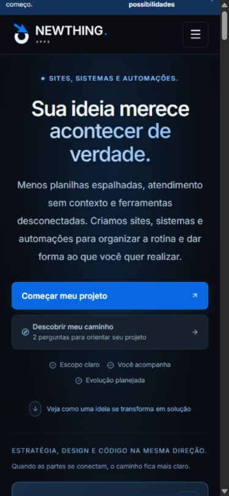
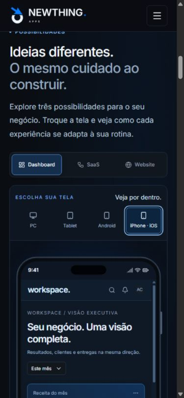
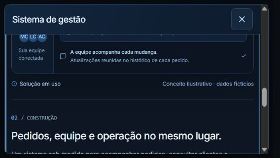
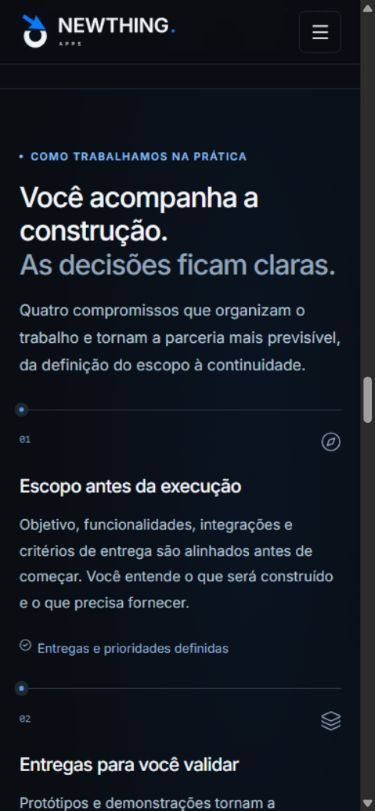
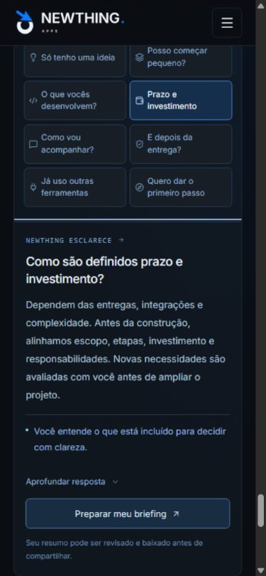
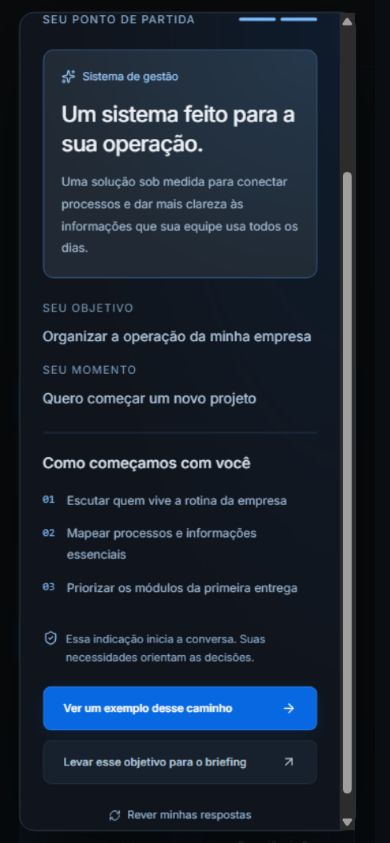
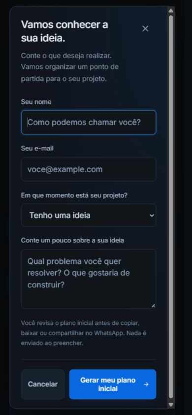

# Revisão completa da interface — 16/10/2026

Revisão da página Newthing, dos fluxos de contato e das demonstrações, preservando a identidade preta e azul e a exibição dos exemplos somente após solicitação.

## Escopo e método

A interface foi operada no navegador integrado: teclas, cliques, campos, abas, filtros, cópia, download, rolagem e fechamento das janelas. A inspeção combinou capturas de tela, leitura da estrutura e medidas do conteúdo renderizado. Os cenários com problemas foram repetidos após a correção.

Foram usados **24 pares de dimensões**, incluindo celulares em pé e na horizontal, tablets e monitores: 320×568, 360×640, 375×667, 390×844, 412×915, 430×932, 560×800, 562×800, 568×320, 667×375, 844×390, 768×1024, 800×600, 802×600, 820×1180, 1024×768, 1100×800, 1102×800, 1180×820, 1280×800, 1366×768, 1440×900, 1920×1080 e 2560×1440. Os valores 562, 802 e 1102 refletem as dimensões efetivas devolvidas pelo navegador nas fronteiras de layout.

## Fluxos conferidos

1. **Entrada, navegação e menu — aprovado após correção.** Os seis destinos existem e são alcançados pelos links. O menu móvel fecha ao selecionar uma seção ou usar Escape; ao abrir, o foco começa no primeiro link. O atalho “Ir para o conteúdo” agora foca o conteúdo principal. Foram conferidos 156 estados de navegação e fechamento.

   

2. **Projetos e dispositivos — aprovado.** Dashboard, SaaS e Website foram combinados com PC, Tablet, Android e iPhone/iOS nas 24 dimensões: **288 combinações**. As regiões internas rolam pelo teclado quando há conteúdo excedente. As interfaces são demonstrações conceituais, não sistemas externos funcionando dentro da página.

   

3. **Jornada e exemplos — aprovado após correção.** Os três exemplos, com três etapas cada, foram verificados nas 24 dimensões: **216 combinações**. Os seis acessos dos cards abriram as etapas correspondentes. Foram exercitados os filtros de mês/trimestre, Todas/Em revisão e a seleção de execuções nas 24 dimensões. Em telas baixas, a janela passou a permitir rolagem do conteúdo completo com o cabeçalho de fechamento acessível. A pausa agora interrompe também os seis ícones de origem/destino, que continuavam animando.

   

4. **Processo, apresentação e equipe — aprovado após correção.** “Como fazemos” usa uma coluna nos celulares e duas nos tablets, evitando parágrafos estreitos. As quatro fotos carregaram pelo R2. Não foram encontrados links locais sem destino nem identificadores duplicados na página. Os links profissionais mantêm seus destinos e abrem outra aba com as proteções de relacionamento existentes.

   

5. **Dúvidas — aprovado.** Os oito assuntos foram selecionados e aprofundados em todas as dimensões: **192 combinações**. A troca de assunto recolhe a resposta anterior e atualiza a associação entre a aba e o painel. Os atalhos Home/End também foram exercitados.

   

6. **Assistente — aprovado após correção.** As quatro intenções e os três momentos resultaram em **288 combinações**, com conferência do exemplo/etapa indicado ou do contexto levado ao briefing. A reabertura rápida de janelas foi exercitada após proteger a restauração do foco contra uma interação nova. O foco não é retirado de outro controle ou de uma janela que acabou de abrir.

   

7. **Briefing, revisão e compartilhamento — aprovado após correção.** Foram conferidos **120 planos**, com as cinco opções em cada dimensão. Campos vazios e e-mail inválido impedem o avanço. Entradas com apenas espaços recebem erro associado ao campo e foco no ponto de correção. Editar preserva os valores e retorna ao nome antes da próxima interação. Abrir o briefing pelo menu móvel e fechá-lo devolve o foco ao menu. Os botões se reorganizam em telas estreitas; as opções do seletor foram encurtadas sem alterar os valores usados no plano. Os campos usam fonte de 16 pixels no celular, e o contraste dos textos de exemplo foi aumentado.

   A cópia retornou confirmação e o conteúdo esperado. O arquivo `.txt` foi efetivamente baixado, lido e conferido. O link gerado aponta para `wa.me/556293022434` com o resumo correspondente; não foi enviada mensagem. Os cinco tipos de plano e a formatação do resumo também têm **10 testes automatizados** em `scripts/project-blueprint.test.mjs`.

   

## Correções encontradas nesta revisão

| Problema observado                                                                              | Correção                                                                 |
| ----------------------------------------------------------------------------------------------- | ------------------------------------------------------------------------ |
| Abrir o menu móvel mantinha o foco no botão e o Tab pulava os links                             | Foco inicial no primeiro destino do menu                                 |
| O atalho de conteúdo deixava o foco no corpo da página                                          | Conteúdo principal recebe foco de fragmento                              |
| Editar o resumo removia o controle focado; uma restauração posterior podia ocorrer tarde demais | Foco definido após a atualização do layout                               |
| Fechar uma janela e iniciar outra interação rapidamente podia reativar o controle anterior      | Restauração respeita o foco atual e outras janelas abertas               |
| Fechar o briefing aberto pelo menu móvel deixava o foco sem destino útil                        | Retorno explícito ao botão do menu                                       |
| Erros por espaços em branco ficavam fora da área visível                                        | Associação do erro aos campos e foco no primeiro campo inválido          |
| Botões e opções longas do formulário não cabiam em 320 pixels                                   | Quebra do rodapé e rótulos menores no seletor                            |
| Exemplos em telas horizontais deixavam uma faixa muito pequena de leitura                       | Rolagem integral em telas baixas, com cabeçalho de fechamento fixo       |
| Pausar luzes deixava seis ícones em movimento                                                   | Regra de pausa cobre os ícones com maior especificidade                  |
| Rótulo de espera da automação excedia a coluna em 320 pixels                                    | Estado abreviado para “Em espera”, com explicação no detalhe da execução |
| O rótulo lateral do workspace excedia a largura intermediária                                   | Espaçamento e padding ajustados                                          |
| Parágrafos de processo estreitos no celular/tablet e placeholders pouco contrastantes           | Reflow em uma/duas colunas e uso do tom de texto secundário da marca     |

O título principal também recebeu um espaço explícito entre seus dois trechos, preservando a separação entre palavras ao extrair o texto.

## Verificação técnica

O [resumo estruturado dos testes](interface-audit/resumo-validacao.json) registra os 24 tamanhos e os resultados das 16 categorias de verificação.

`npm run lint`, `npm run typecheck`, `npm run test:unit`, `npm run build` e `git diff --check` passaram. A versão compilada foi aberta separadamente em 320×568, 568×320, 802×600, 1366×768 e 2560×1440. Foram conferidos reflow, briefing, edição, destino do WhatsApp, abertura dos exemplos e pausa. Não houve erros ou avisos de console nessa prévia.

## Limites da evidência

Os resultados correspondem à emulação de dimensões no navegador disponível. As molduras Android/iOS representam apresentações do produto; não equivalem à execução física nesses sistemas. Não foram executados Safari, Firefox, leitores de tela, dispositivos físicos ou testes de entrega de mensagens pelo WhatsApp. A preferência de redução de movimento estava ativada no ambiente; as sequências de luz solicitadas anteriormente mantêm seu controle local de pausa, que foi testado. As demais regras de redução de movimento foram preservadas.

A inspeção de transbordamento não trata o brilho decorativo das marcas como texto excedente. As regiões de demonstração continuam com rolagem vertical quando seu conteúdo é maior que a área disponível. Não se afirma certificação integral de acessibilidade.

Os registros detalhados desta execução ficam junto às capturas na pasta local de evidências `C:/Users/User/.codex/visualizations/2026/10/16/newthing/revisao-completa/`. Não foram usados os registros de uma auditoria anterior como evidência desta revisão.
